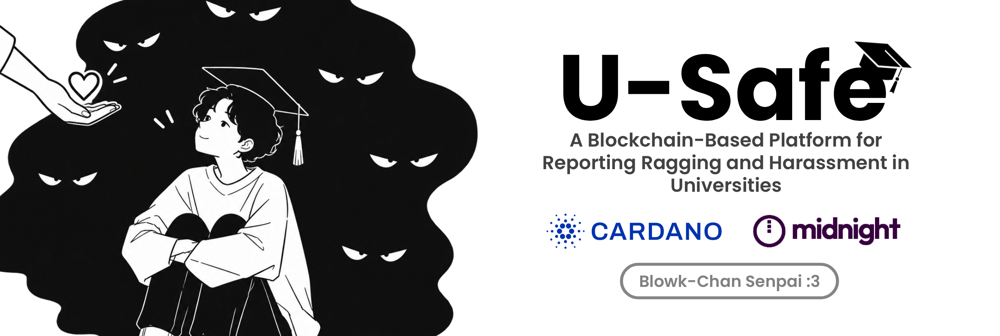

# U-Safe : Report without fear.
  

U-Safe is a blockchain-based platform that lets university students report ragging and harassment confidentially, using Cardano for tamper-proof records and Midnight for privacy-preserving data protection.